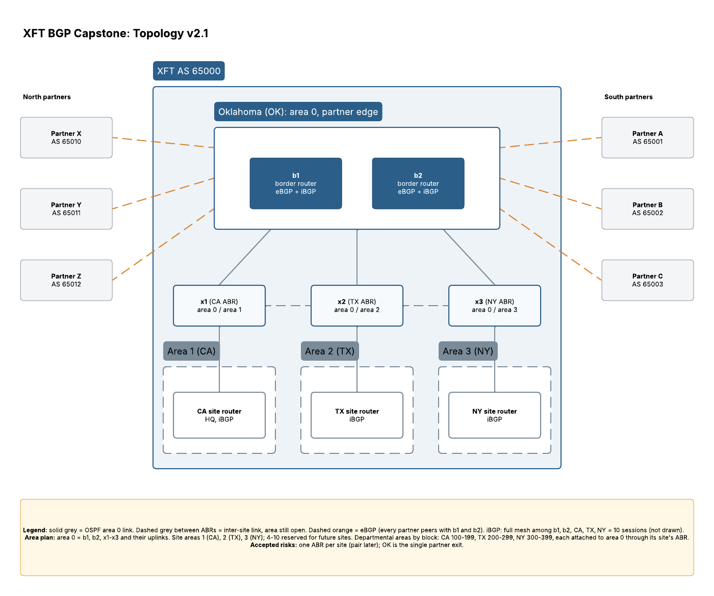

# XFT BGP Capstone

A business-framed BGP design-and-build capstone: **XFT**, a fictional company,
runs a single autonomous system and progressively peers with six partner
companies. Every version is designed on paper first (design doc + topology
figure), attacked for failure modes, then built and verified in a containerlab
topology with FRRouting — captures and all.

This is the capstone of a months-long L2/L3 networking deep-dive (OSPF
multi-area, eBGP policy, iBGP route reflection) done create → break → learn style.

## Current state — v2.1 (design)

- **XFT, AS 65000.** Sites: California (HQ), Texas, New York, and **Oklahoma —
  the partner edge**, hosting border routers **b1 and b2** (eBGP + iBGP).
- **Every partner dual-homes to b1 and b2.** South: A (AS 65001), B (65002),
  C (65003). North: X (65010), Y (65011), Z (65012).
- **XFT is not transit** — nothing is passed between partners (v2 ruling).
- **iBGP:** full mesh among b1, b2, CA, TX, NY — 10 sessions. Route reflectors
  planned for OK as sites grow.
- **OSPF (new in v2.1):** area 0 = b1, b2, each site's ABR (x1/x2/x3) and their
  links. Site areas: 1 = CA, 2 = TX, 3 = NY (4–10 reserved). Departmental
  areas in per-site blocks: CA 100–199, TX 200–299, NY 300–399 — attached to
  area 0 only through the site's ABR. Flooding stays local; summaries cross
  the long-haul.

### Accepted risks / open items (on the record)

- **OK is the single partner exit** — losing the site cuts off every partner.
- **One ABR per site** (pair planned) — losing a site's ABR isolates its areas.
- Open: which area the CA–TX / TX–NY links belong to; what areas 1–3 contain
  beyond the site router.

## Design evolution

| Version | What changed | Figure |
|---|---|---|
| v1.2 | 3 sites, OSPF backbone, iBGP mesh; TX = accepted SPOF for CA–NY | [v1.2](docs/topology-v1.2.png) |
| v2.0 | Oklahoma partner edge (b1/b2), partners dual-homed, sites iBGP-only; TX SPOF removed | [v2.0](docs/topology-v2.0.png) |
| v2.1 | Full OSPF area plan (site + departmental blocks, per-site ABRs); no-transit ruling | [v2.1](docs/topology-v2.1-ospf.png) |

## Roadmap

| Next | Scope |
|---|---|
| Prefix policy | What XFT advertises to each partner; what it accepts; filters enforcing no-transit both directions |
| v2 build | containerlab: OSPF areas + iBGP mesh + dual-homed eBGP, verified with captures |
| v3+ | Traffic engineering (local-pref, prepending, MED), failure injections, convergence; route reflectors in OK |

## Design documents

- [`docs/BGP_Project_Capstone_v2.1.docx`](docs/BGP_Project_Capstone_v2.1.docx) — the design doc (current)
- `lab/` — containerlab topology + FRR configs (lands with the v2 build)

## Toolchain

containerlab · FRRouting 9.1 · Lima VM (macOS) · Wireshark/tshark for every claim
