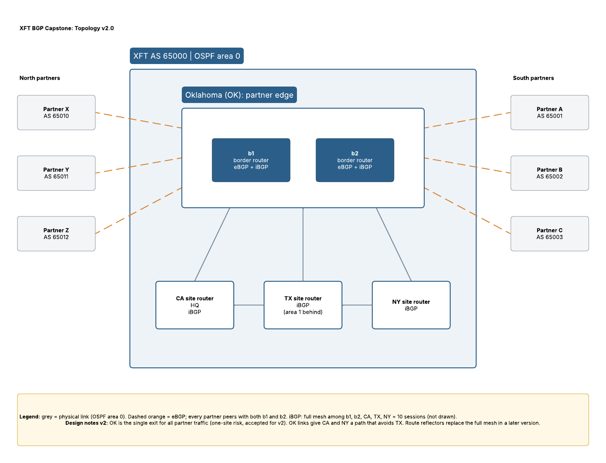

# XFT BGP Capstone

A design-first network build. **XFT** is a fictional company with four sites and
six partner companies; this repo carries its network from a written design
through generated configuration to a running lab.

Every version is designed on paper first, attacked for failure modes, then built
in containerlab with FRRouting and verified with captures. The configuration is
generated from a single intent file rather than typed into routers — the same
link table that cables the lab also addresses the interfaces and assigns the
OSPF areas, so the two can never disagree.



## The design

**XFT, AS 65000.** California (HQ), Texas and New York are branch sites;
**Oklahoma is the partner edge**, hosting the border routers that run eBGP to
every partner and iBGP into the network.

- **OSPF** — area 0 is the backbone: every inter-site cable, plus each site's
  ABR and the Oklahoma routers. Each site owns a block of 100 area numbers
  (CA 100–199, TX 200–299, NY 300–399); the first is the site's core area, the
  rest are departments. Department areas are totally stubby, so a department
  router sees its own area and one default route to its ABR.
- **iBGP** — route reflectors in Oklahoma replace the full mesh: 17 sessions at
  the target size instead of 45. Every router in the forwarding path to the
  partners is an RR client, so none of them black-holes partner traffic.
- **eBGP** — each partner peers with both border routers. XFT is a multihomed
  **non-transit** AS: an outbound prefix list on every partner session permits
  only XFT's own prefixes, so partner traffic is never carried between partners.

Full reasoning, alternatives considered, and accepted risks:
[`docs/XFT BGP Capstone – Design Decisions (v2.5).docx`](docs/).

## Configuration as code

```
intent/*.yml  →  validate  →  render  →  plan  →  apply  →  verify
```

`intent/topology.yml` is the catalogue of every router and cable in the target
design. A **scope** selects what to build now, naming routers only — a link is
in scope when both of its routers are, so adding a router pulls in its cables
automatically and the two lists cannot drift apart.

```bash
python -m xft.render.clab --list          # what this scope builds, and what it holds back
python -m xft.render.clab                 # write lab/xft.clab.yaml  (mvp: 10 routers, 11 links)
python -m xft.render.clab --scope full    # the whole target        (15 routers, 22 links)
python -m xft.render.clab --check         # non-zero exit if the generated file is stale
```

The current scope is the **MVP**: one route reflector, one border router, and
one partner on each side. The pieces that are missing keep their addresses
reserved in the catalogue, so nothing renumbers when they arrive — growing the
build is one name at a time in `scopes.mvp.routers`.

## Progress

| Phase | | |
|---|---|---|
| 0 | Link table as intent, containerlab generated from it | done |
| 1 | Deploy the MVP topology | next |
| 2 | OSPF rendered and pushed; gate on adjacencies Full | |
| 3 | iBGP sessions derived from reflector/client flags | |
| 4 | eBGP with the non-transit filter generated, not typed | |
| 5 | Verify and drift detection from `show ... json` | |
| 6 | CI: validate, render and test on every pull request | |

Detail and open questions: [`PLAN.md`](PLAN.md).

## Background

This is the capstone of a months-long study of L2/L3 from first principles —
OSPF multi-area, eBGP policy and traffic engineering, iBGP route reflection —
built create → break → learn, with every claim checked on the wire.

## Toolchain

containerlab · FRRouting 9.1 · Python (PyYAML, Pydantic, Jinja2, pytest) ·
Lima VM on macOS · Wireshark/tshark
