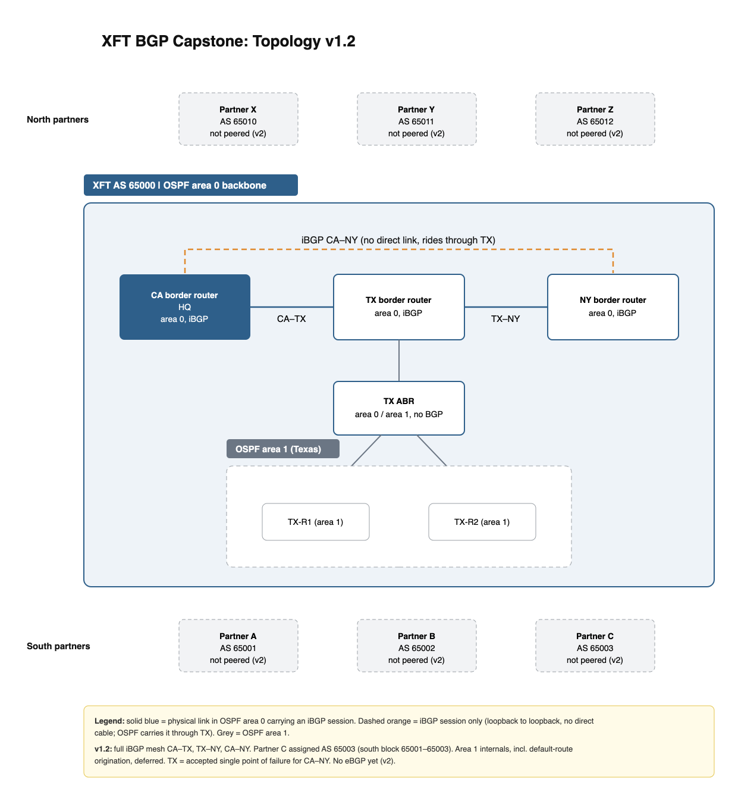

# XFT BGP Capstone

A business-framed BGP design-and-build capstone: **XFT**, a fictional company with
three sites, runs a single autonomous system and progressively peers with six
partner companies. Every version is designed on paper first (one-pager + topology
figure), attacked for failure modes, then built and verified in a containerlab
topology with FRRouting — captures and all.

This is the capstone of a months-long L2/L3 networking deep-dive (OSPF multi-area,
eBGP policy, iBGP route reflection) done create → break → learn style.

## Current state — v1.2 (design)

- **XFT, AS 65000** — three sites: California (HQ), Texas, New York.
- **OSPF area 0 backbone** across all three sites; Texas hangs an **area 1**
  (TX-R1, TX-R2) off an ABR.
- **Full iBGP mesh** between the CA, TX, and NY border routers. There is no
  direct CA–NY link: that session rides through TX, loopback to loopback.
- **Partners not yet peered** (arrives in v2):
  - South: A (AS 65001), B (AS 65002), C (AS 65003)
  - North: X (AS 65010), Y (AS 65011), Z (AS 65012)

### Accepted risks / deferrals (on the record)

- **TX is a single point of failure** for CA↔NY — only physical path and iBGP
  transit. Accepted for v1; revisit when a CA–NY link is priced.
- **Area 1 internals** (including default-route origination) deferred.

## Roadmap

| Version | Scope |
|---|---|
| v1 | Build XFT internals in containerlab: OSPF backbone + iBGP mesh, verify the CA–NY session transits TX |
| v2 | eBGP to the six partners: prefix exchange policy, filters both directions, no accidental transit |
| v3+ | Traffic engineering (local-pref, prepending, MED on parallel links), failure injections, convergence captures |

## Design documents

- [`docs/BGP_Project_Capstone_v1.2.docx`](docs/BGP_Project_Capstone_v1.2.docx) — the one-pager
- `lab/` — containerlab topology + FRR configs (lands with v1 build)

## Toolchain

containerlab · FRRouting 9.1 · Lima VM (macOS) · Wireshark/tshark for every claim
